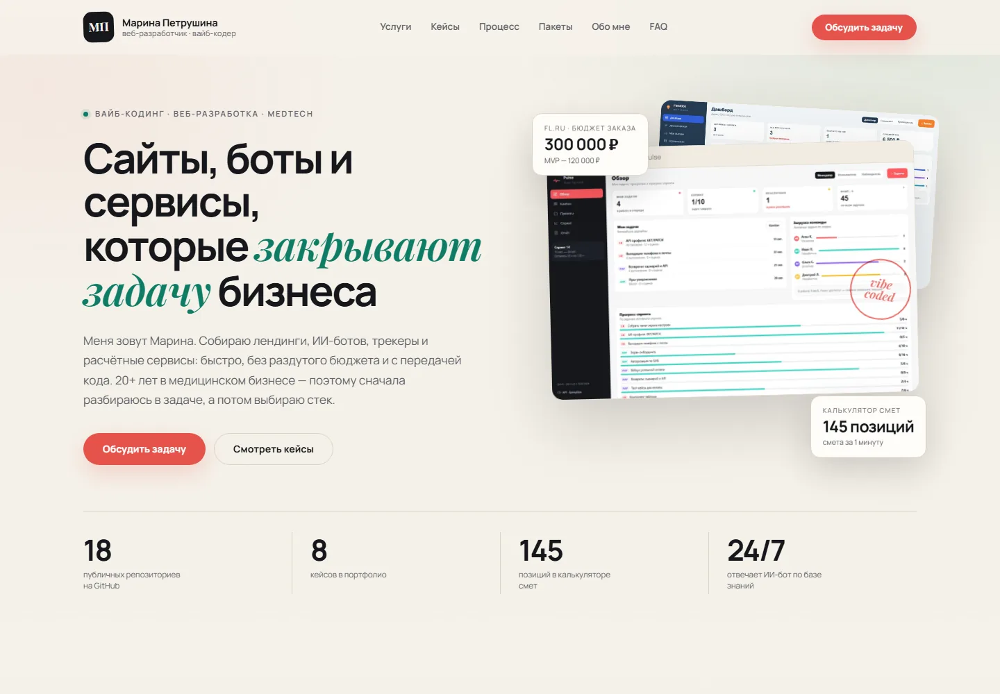
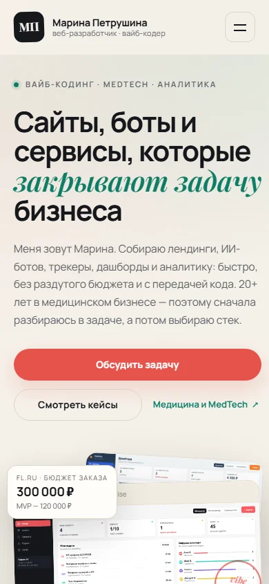
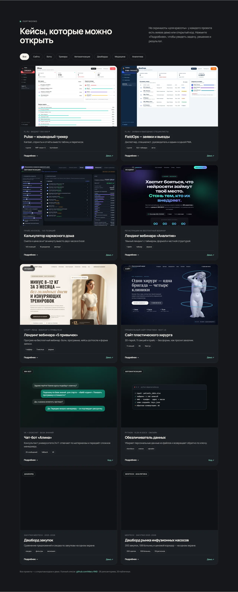

# Портфолио вайб-кодера — Марина Петрушина

Одностраничный сайт-портфолио для фриланс-практики: сайты, ИИ-боты, трекеры задач и автоматизация для малого бизнеса и MedTech.

**Живая версия:** [mary-rnd.github.io/portfolio](https://mary-rnd.github.io/portfolio/)

[](https://mary-rnd.github.io/portfolio/)
[](https://developer.mozilla.org/docs/Web/HTML)
[](https://developer.mozilla.org/docs/Web/CSS)
[](https://developer.mozilla.org/docs/Web/JavaScript)

## Скриншоты

| Desktop | Mobile |
| --- | --- |
|  |  |



## Что внутри

- Светлый editorial-дизайн: кремовый фон, графит, изумруд и коралловый CTA.
- 8 кейсов с фильтрами по категориям: сайты, трекеры, автоматизация, MedTech.
- Карточки кейсов с задачей, решением, стеком, сроком и ценой.
- Модальные окна с подробным разбором каждого кейса.
- Блок услуг и пакетов «База» / «База+».
- FAQ, процесс работы и форма заявки.
- Адаптив для desktop, tablet и mobile, поддержка `prefers-reduced-motion`.
- Самохостинг шрифтов Manrope и Playfair Display, без внешних CDN.
- SEO-разметка `Person` (JSON-LD), Open Graph и favicon.

## Стек

- HTML5, CSS3 (custom properties, grid, flexbox).
- Vanilla JavaScript: фильтры, модальные окна, мобильное меню, валидация формы.
- Python Playwright для локальной проверки и скриншотов.
- GitHub Pages для публикации.

## Структура

```text
portfolio/
├─ index.html
├─ assets/
│  ├─ styles.css
│  ├─ app.js
│  ├─ fonts/
│  └─ img/
├─ screenshots/
├─ LICENSE
└─ README.md
```

## Локальный запуск

```bash
python -m http.server 8777
# http://127.0.0.1:8777/
```

## Кейсы

- [Pulse — трекер задач](https://mary-rnd.github.io/pulse/)
- [FieldOps — заявки и выезды](https://mary-rnd.github.io/fieldops/)
- [Tracker Cases — 5 сценариев](https://mary-rnd.github.io/tracker-cases/)
- [Task Dispatcher — командный центр](https://mary-rnd.github.io/task-dispatcher/)
- [EventFlow — участники мероприятия](https://mary-rnd.github.io/eventflow/)
- [Route Planner — планировщик путешествий](https://mary-rnd.github.io/route-planner/)
- [Калькулятор каркасного дома](https://mary-rnd.github.io/karkas-dom-calculator/)
- [Пластическая хирургия — 3D-лендинг](https://mary-rnd.github.io/plastic-surgery-landing/)
- [Лендинг вебинара по ИИ-аналитике](https://mary-rnd.github.io/vebinar-ii-analitik-landing/)
- [Дашборд закупок MedTech](https://mary-rnd.github.io/procurement-demo/)
- [Аналитика рынка инфузионных насосов](https://mary-rnd.github.io/infusion-pumps-dashboard/)
- [ИИ-бот для VK](https://github.com/Mary-RND/vk-ai-assistant)

## Контакты

- Telegram: [@marypetrova6](https://t.me/marypetrova6)
- VK: [@marina_petrushina](https://vk.com/marina_petrushina)
- WhatsApp: [+7 (985) 728-66-55](https://wa.me/79857286655)
- Email: [mar.petrushina@yandex.ru](mailto:mar.petrushina@yandex.ru)
- GitHub: [@Mary-RND](https://github.com/Mary-RND)

## Лицензия

Код сайта — MIT. Тексты, фотографии и кейсы принадлежат автору; перед использованием в чужих проектах согласуйте отдельно.
